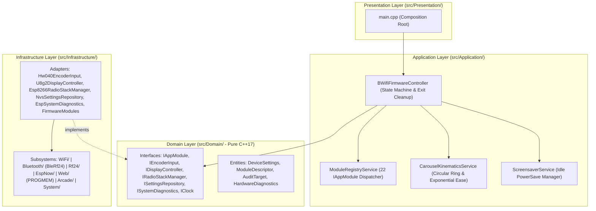
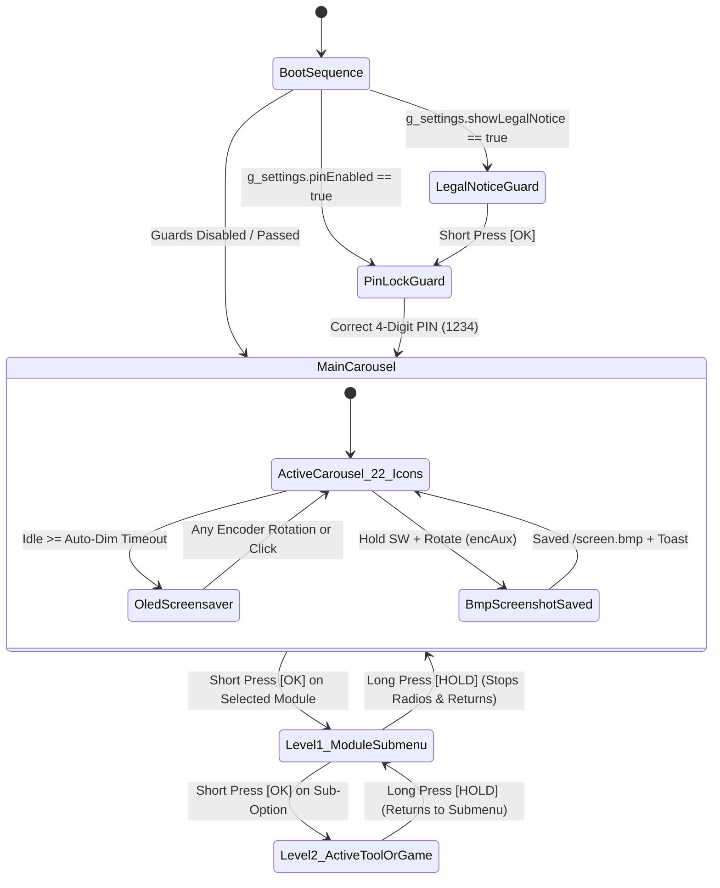

# BWifi-ESP8266

**Multi-Tool 2.4 GHz RF Spectrum Analyzer, Defensive WiFi Auditing Suite, Software-Defined BLE-over-nRF24 Tracker Radar & Advertiser, Wireless UDP/ESP-NOW HID + Ducky Script Engine, ESP-NOW Controller & 10-in-1 Retro Arcade Firmware for ESP8266 (`NodeMCU` / `Wemos D1 Mini`)**

[](https://www.espressif.com/en/products/socs/esp8266)
[](https://en.cppreference.com/w/cpp/17)
[](#system-architecture)
[](#whats-new-in-v35-v34--v33)
[](https://platformio.org/)
[](https://github.com/olikraus/u8g2)
[](https://nrf24.github.io/RF24/)
[](#05-ble-trackers-srcinfrastructurebluetoothble_trackerscpp--3-submodes)
[](#rotary-encoder-hw-040-control-system--api)
[](Disclaimer.md)
[](LICENSE)

---

> [!IMPORTANT]
> **LEGAL DISCLAIMER & ETHICAL USE REQUIREMENT (`LAB MODE` ONLY)**  
> **BWifi-ESP8266** is developed strictly for **authorized security auditing, academic research, RF spectrum diagnostics, and controlled laboratory environments**. Misuse of active wireless or RF features on networks or devices without prior written authorization may violate local and international telecommunications laws (**FCC**, **RED**, **INDOTEL**, **ITU**).  
> Please read the full **[Legal Disclaimer & Ethical Use Policy (`Disclaimer.md`)](Disclaimer.md)** before building, flashing, or operating this firmware.

---

**BWifi-ESP8266 (BWifi8266 v3.5)** is the **ESP8266 (`ESP8266EX @ 160 MHz`, NodeMCU v2/v3 or Wemos D1 Mini)** edition of the **BWifi v3.5** wireless diagnostics, defensive cybersecurity auditing, RF spectrum visualization, and embedded productivity suite. Structured in **Self-Contained Clean Architecture (C++17)** with **CMake (`CMakeLists.txt`)** and **PlatformIO** support, it preserves all **22 top-level modules**, the smooth **3-icon graphical carousel**, deterministic **Rotary Encoder HW-040 (KY-040)** control with `IRAM_ATTR` interrupts, **7 defensive WiFi auditing submodes** (`Probe+MAC RND`, `Heatmap`, `Wardrive+Kismet`, `Rogue AP/Evil Twin`, `Hidden SSID Unmasker`, `Karma/Pineapple`, `PCAP .pcap`), the **4-view 2.4 GHz Spectrum Analyzer** (`Bar Histogram + Peak Hold`, `2D Waterfall`, `RF Fingerprint IA` with 3 visual protocol bars, and `MouseJack / ESB Lab`), the **Ducky Script (`/payload.txt`) interpreter** with `ES/US` layout mapping and live progress bar, **`LittleFS`** log management, **1-bit `.bmp` OLED screenshot export** (`/screen.bmp`), and the **10-in-1 Retro Arcade Console** (`Snake`, `Pong`, `Flappy`, `Invaders`, `Dino`, `Breakout`, `Simon`, `Tetris`, `Asteroids`, `2048`), while introducing **software-defined BLE packet synthesis and demodulation (`ADV_NONCONN_IND`) with log-distance meter estimation over the `nRF24L01+` transceiver (`BleRf24`)** and **automatic Single/Dual `nRF24L01+` hardware detection (`g_dualRadioAvailable`)**.

---

## Table of Contents

- [Legal Disclaimer & Ethical Use (`Disclaimer.md`)](#legal-disclaimer--ethical-use-disclaimermd)
- [Features](#features)
- [Key Features](#key-features)
- [Key ESP8266 Architecture Adaptations](#key-esp8266-architecture-adaptations)
- [What's New in v3.5, v3.4 & v3.3](#whats-new-in-v35-v34--v33)
- [Added Functions & Modules by File](#added-functions--modules-by-file)
- [System Architecture](#system-architecture)
  - [Layer Separation](#layer-separation)
  - [Layered Architecture Diagram](#layered-architecture-diagram)
  - [Navigation State Machine & Hierarchical Submenu Workflow](#navigation-state-machine--hierarchical-submenu-workflow)
  - [Directory Tree](#directory-tree)
- [Hardware Specifications & Step-by-Step Wiring Guide (NodeMCU / Wemos D1 Mini)](#hardware-specifications--step-by-step-wiring-guide-nodemcu--wemos-d1-mini)
  - [Bill of Materials (BOM)](#bill-of-materials-bom)
  - [Step 1: Wire the SSD1306 128×64 I2C OLED Display](#step-1-wire-the-ssd1306-12864-i2c-oled-display)
  - [Step 2: Wire the Rotary Encoder HW-040 (KY-040)](#step-2-wire-the-rotary-encoder-hw-040-ky-040)
  - [Step 3: Wire the Single or Dual `nRF24L01+PA+LNA` Radios (Hardware HSPI)](#step-3-wire-the-single-or-dual-nrf24l01palna-radios-hardware-hspi)
  - [Block Wiring Diagram (NodeMCU v2/v3 & Wemos D1 Mini)](#block-wiring-diagram-nodemcu-v2v3--wemos-d1-mini)
  - [Single-Radio vs. Dual-Radio Auto-Detection (`g_dualRadioAvailable`)](#single-radio-vs-dual-radio-auto-detection-g_dualradioavailable)
  - [Step-by-Step Hardware Assembly & Power Decoupling](#step-by-step-hardware-assembly--power-decoupling)
- [Core Algorithms & Mathematical Models](#core-algorithms--mathematical-models)
  - [Deterministic 7-State Gray-Code Quadrature Automaton](#deterministic-7-state-gray-code-quadrature-automaton)
  - [Software-Defined BLE Advertising & Demodulation over `nRF24L01+` (`BleRf24`)](#software-defined-ble-advertising--demodulation-over-nrf24l01-blerf24)
  - [Exponential Decay Carousel Kinematics](#exponential-decay-carousel-kinematics)
  - [BLE Log-Distance Path Loss Distance Estimator](#ble-log-distance-path-loss-distance-estimator)
  - [2.4 GHz Spectral Fingerprinting Classifier](#24-ghz-spectral-fingerprinting-classifier)
  - [1-Bit Monochrome BMP Framebuffer Serializer](#1-bit-monochrome-bmp-framebuffer-serializer)
- [Rotary Encoder HW-040 Control System & API](#rotary-encoder-hw-040-control-system--api)
- [Step-by-Step Operating Guide to All 22 Modules](#step-by-Step-operating-guide-to-all-22-modules)
  - [01. WIFI SCANNER (`src/Infrastructure/WiFi/wifiscan.cpp`)](#01-wifi-scanner-srcinfrastructurewifiwifiscancpp)
  - [02. WIFI AUDIT PRO (`src/Infrastructure/WiFi/wifi_tools.cpp`) — 7 Submodes](#02-wifi-audit-pro-srcinfrastructurewifiwifi_toolscpp--7-submodes)
  - [03. ANALIZADOR (`src/Infrastructure/Rf24/spectrograph.cpp`) — 4 RF Views](#03-analizador-srcinfrastructurerf24spectrographcpp--4-rf-views)
  - [04. BT SCANNER (`src/Infrastructure/Bluetooth/btscan.cpp`)](#04-bt-scanner-srcinfrastructurebluetoothbtscancpp)
  - [05. BLE TRACKERS (`src/Infrastructure/Bluetooth/ble_trackers.cpp`) — 3 Submodes](#05-ble-trackers-srcinfrastructurebluetoothble_trackerscpp--3-submodes)
  - [06. PACKET MONITOR (`src/Infrastructure/WiFi/packet_monitor.cpp`)](#06-packet-monitor-srcinfrastructurewifipacket_monitorcpp)
  - [07. MODO CENTINELA (`src/Infrastructure/WiFi/centinela.cpp`)](#07-modo-centinela-srcinfrastructurewificentinelacpp)
  - [08. JAMMER CANAL (`src/Infrastructure/Rf24/jammer.cpp`)](#08-jammer-canal-srcinfrastructurerf24jammercpp)
  - [09. BARRIDO TOTAL (`src/Infrastructure/Rf24/total_jammer.cpp`)](#09-barrido-total-srcinfrastructurerf24total_jammercpp)
  - [10. BT JAMMER (`src/Infrastructure/Bluetooth/bt_jammer.cpp`)](#10-bt-jammer-srcinfrastructurebluetoothbt_jammercpp)
  - [11. BEACON SPAM (`src/Infrastructure/WiFi/beacon_spam.cpp`)](#11-beacon-spam-srcinfrastructurewifibeacon_spamcpp)
  - [12. BLE SPAM (POP) (`src/Infrastructure/Bluetooth/ble_spam.cpp`) — 5 Modes](#12-ble-spam-pop-srcinfrastructurebluetoothble_spamcpp--5-modes)
  - [13. MODO HIBRIDO (`src/Infrastructure/Rf24/hybrid_attack.cpp`)](#13-modo-hibrido-srcinfrastructurerf24hybrid_attackcpp)
  - [14. EVIL PORTAL (`src/Infrastructure/WiFi/evil_portal.cpp`)](#14-evil-portal-srcinfrastructurewifievil_portalcpp)
  - [15. IP SCANNER (`src/Infrastructure/WiFi/ip_scanner.cpp`) — Ping, Port Scan & DHCP/NTP Audit](#15-ip-scanner-srcinfrastructurewifiip_scannercpp--ping-port-scan--dhcpntp-audit)
  - [16. CONTROL ESCLAVO (`src/Infrastructure/EspNow/slave.control.cpp`)](#16-control-esclavo-srcinfrastructureespnowslavecontrolcpp)
  - [17. WEB DASHBOARD (`src/Infrastructure/Web/web_server.h`, `src/Infrastructure/Web/web_dashboard.cpp`)](#17-web-dashboard-srcinfrastructurewebweb_serverh-srcinfrastructurewebweb_dashboardcpp)
  - [18. REMOTE HID/UDP (`src/Infrastructure/Bluetooth/bt_remote.cpp`) — 7 HID Submodes + Ducky Script](#18-remote-hidudp-srcinfrastructurebluetoothbt_remotecpp--7-hid-submodes--ducky-script)
  - [19. LEER LOGS (`src/Infrastructure/System/log_viewer.cpp`)](#19-leer-logs-srcinfrastructuresystemlog_viewercpp)
  - [20. ARCADE (`src/Infrastructure/Arcade/games_menu.cpp`) — 10-in-1 Retro Console](#20-arcade-srcinfrastructurearcadegames_menucpp--10-in-1-retro-console)
  - [21. AJUSTES / TEST (`src/Infrastructure/Config/settings_menu.cpp`) — EEPROM Settings & Self-Test](#21-ajustes--test-srcinfrastructureconfigsettings_menucpp--eeprom-settings--self-test)
  - [22. ABOUT (`src/Infrastructure/System/about_info.cpp`)](#22-about-srcinfrastructuresystemabout_infocpp)
- [Web Dashboard Command Center v3.5 & REST API](#web-dashboard-command-center-v35--rest-api)
  - [HTTP Endpoints Topology](#http-endpoints-topology)
  - [Live JSON Telemetry Payload (`/api/status`)](#live-json-telemetry-payload-apistatus)
  - [Ducky Script Language Reference (`/payload.txt`)](#ducky-script-language-reference-payloadtxt)
  - [Remote HID UDP (`4210`) & ESP-NOW Packet Format](#remote-hid-udp-4210--esp-now-packet-format)
- [Step-by-Step Build & Flashing Instructions](#step-by-step-build--flashing-instructions)
  - [Prerequisites](#prerequisites)
  - [Step 1: Clone or Open the Project](#step-1-clone-or-open-the-project)
  - [Step 2: Review `platformio.ini` & CMake Configuration](#step-2-review-platformioini--cmake-configuration)
  - [Step 3: Compile the Firmware (PlatformIO & CMake)](#step-3-compile-the-firmware-platformio--cmake)
  - [Step 4: Flash to ESP8266 via PlatformIO](#step-4-flash-to-esp8266-via-platformio)
  - [Step 5: Verify Hardware with Built-in `SELF-TEST HW`](#step-5-verify-hardware-with-built-in-self-test-hw)
- [Troubleshooting & Diagnostics](#troubleshooting--diagnostics)
- [Roadmap (`v3.3` → `v4.0`)](#roadmap-v33--v40)
- [License](#license)
- [Contact](#contact)
- [Support](#support)

---

## Legal Disclaimer & Ethical Use (`Disclaimer.md`)

All users, researchers, and contributors must adhere to the policies defined in **[`Disclaimer.md`](Disclaimer.md)**:

1. **[Purpose & Intended Scope](Disclaimer.md#1-purpose-and-intended-scope)**: Strictly limited to educational exploration, defensive monitoring, spectrum diagnostics, and authorized laboratory testing (`LAB MODE`).
2. **[Regulatory Compliance](Disclaimer.md#2-regulatory--legal-compliance)**: Compliance with **FCC Part 15**, **EU RED 2014/53/EU**, **INDOTEL Ley No. 153-98**, and **ITU** regulations is mandatory.
3. **[Built-in Firmware Safeguards](Disclaimer.md#3-built-in-hardware--software-safeguards)**: Includes a configurable **Boot Legal Notice (`AVISO LAB`)**, **4-Digit Startup PIN Lock (`1234`)**, **Operating Profile Selector (`LAB / AUDIT / DEMO`)**, and **Hardware Self-Test** stored in non-volatile memory (`EEPROM`).
4. **[Limitation of Liability](Disclaimer.md#4-limitation-of-liability)**: Provided `"AS IS"` without warranty; the user assumes full legal responsibility for operation.

---

## Features

| Feature | Description |
|---|---|
| **WiFi Defense & Discovery Suite** | 7-in-1 passive auditing engine: **Probe Sniffer + MAC Randomizer Detector**, **Channel Heatmap (`1..13`)**, **Wardriving + Kismet CSV Logger**, **Rogue AP / Evil Twin Detector**, **Hidden SSID Unmasker**, **Karma / Pineapple Detector**, and **`.pcap` Packet Capture (`libpcap`)** |
| **Single / Dual `nRF24L01+` 2.4 GHz Engine** | Auto-detects 1 or 2 `nRF24L01+ PA+LNA` transceivers (`g_dualRadioAvailable`) to scan and generate carriers across all **126 ISM channels (`2.400–2.525 GHz`)** over hardware HSPI |
| **4-View Spectrum Analyzer** | Instant `OK` toggle between **Real-Time Bar Histogram + Peak Hold**, **2D Temporal Waterfall (40×126)**, **AI RF Spectrum Fingerprint Classifier (`WiFi / BLE / Zigbee / ESB` with 3 visual energy bars)**, and **MouseJack / ESB Sniffer + Lab Replay** |
| **BLE-over-nRF24 Anti-Tracking Radar & Distance Meter** | Synthesizes and demodulates BLE advertising frames on channels `37/38/39` via `BleRf24` (`CRC24` + 7-bit LFSR whitening) to detect **Apple AirTag / FindMy (`0x004C`)**, **Samsung SmartTag (`0x0075`)**, **Tile (`0xFEED`/`0xFEEC`)**, **Chipolo (`0xFE65`/`0xFE33`)**, and **Google Find My (`0xFE2C`)**, with a **2-mode List + `detailMode` Geiger view**, alert banner, real-time distance estimation in meters ($d = 10^{(-59-\text{RSSI})/(10 \times 2.2)}$), and `/trackers.txt` logging |
| **iBeacon Transmitter & Multi-OS BLE Advertising** | Real-time configurable **Apple iBeacon Emitter** (`Minor 1..99` via rotary encoder) and 5-mode proximity popup generator (`Apple iOS`, `Windows Swift Pair`, `Android Fast Pair`, `Samsung Galaxy Buds`, `Multi-OS Auto-Cycle`) synthesized over `nRF24L01+` |
| **Wireless UDP / ESP-NOW HID + Ducky Script Parser** | 7-mode remote HID controller (`Media`, `Mouse`, `Reels/PPT`, `Ducky Script /payload.txt` with progress bar & abort, `Keyboard Layout ES/US`, `Gamepad Stick`, `Quick Macro`) broadcasting over UDP (`:4210`) and ESP-NOW |
| **LAN IP Scanner + DHCP & NTP Auditor** | Active subnet host discovery (`1..254`) via ICMP Ping (`ESP8266Ping`) with **average RTT latency (`ms`)**, OS/service fingerprinting (`Apple`, `Windows`, `Android/IoT`, `Web/Router`, `NAS`), UDP stress test, **DHCP Gateway/DNS consistency check**, and **UTC NTP clock synchronization** |
| **Web Command Center v3.5 (`PROGMEM`)** | Zero-RAM-overhead web server (`ESP8266WebServer` on `http://192.168.4.1`) with unique ChipID SSID `BW8266-<ChipID>`, live JSON telemetry (`/api/status`), online **Ducky Script Editor**, **Arcade Leaderboard** (`/api/leaderboard` & `/get-scores`), and 1-click downloads for `.pcap`, `.csv`, `.txt`, and `.bmp` OLED screenshots (`/snap-bmp` & `/download-screen`) |
| **10-in-1 Retro Arcade Console** | 10 full games tailored for the rotary encoder (`Snake`, `Pong`, `Flappy Bird`, `Space Invaders`, `Dino Run`, `Breakout`, `Simon Memory`, `Tetris`, `Asteroids`, `2048 Puzzle`) with high scores persisted in `EEPROM` |
| **OLED `.BMP` Screenshot & UI Themes** | Instant 1-bit `128×64` Windows `.bmp` (`1086 bytes`) framebuffer export to `/screen.bmp` via `SW + Rotate` (`"BMP GUARDADO!"` toast), Web Dashboard, or Settings, plus 3 UI themes (`CLASICO`, `INVERSO`, `RETRO`) |

---

## Key Features

| Subsystem | Technical Implementation | Benefit |
|---|---|---|
| **Clean Architecture (C++17) + CMake** | Strict 4-layer separation (`Domain`, `Application`, `Infrastructure`, `Presentation`) + `CMakeLists.txt` (`HOST_BUILD`) | Pure C++17 business logic (`BWifiFirmwareController`, `CarouselKinematicsService`, `ScreensaverService`, `ModuleRegistryService`) decoupled from ESP8266 SDK |
| **7-State Gray-Code Encoder Driver + `swIsr`** | Deterministic Buxton automaton (`kBuxtonTable[7][4]`) + falling-edge switch ISR (`swIsr`) in [`src/Infrastructure/Input/encoder_input.cpp`](src/Infrastructure/Input/encoder_input.cpp) | Zero missed steps or button clicks during heavy WiFi/SPI transfers; `< 5 ms` mechanical bounce guard |
| **400 kHz I2C OLED Pipeline** | `U8G2_SSD1306_128X64_NONAME_F_HW_I2C` configured via `U8g2DisplayController` with exponential frame interpolation | Smooth 3-icon carousel and responsive real-time spectrum graphs |
| **Automatic `LittleFS` Log Rotation** | `rotateLogIfNeeded(path, 16384)` in [`src/Infrastructure/Config/settings_menu.cpp`](src/Infrastructure/Config/settings_menu.cpp) rotates `/logins.txt`, `/wardrive.csv`, `/trackers.txt`, and `/capture.pcap` to `.1` backups | Prevents flash filesystem exhaustion during long auditing sessions |
| **`PROGMEM` Flash Optimization** | All Captive Portal templates (`portals.h`) and Web Command Center HTML (`web_server.h`) stored in `PROGMEM` and streamed via `send_P()` | Preserves > 32 KB free DRAM out of the ESP8266's 80 KB RAM |

---

## Key ESP8266 Architecture Adaptations

| Subsystem | In `BWifi-ESP32` | In `BWifi-ESP8266` |
|---|---|---|
| **MCU & Clock Frequency** | ESP32 Dual-Core @ 240 MHz | ESP8266EX @ **160 MHz** (`board_build.f_cpu = 160000000L`) |
| **WiFi Frame Injection & Sniffing** | `esp_wifi_80211_tx` / `esp_wifi_set_promiscuous` | `wifi_send_pkt_freedom()` / `wifi_set_promiscuous_rx_cb()` (`<user_interface.h>`) |
| **BLE Spam, iBeacon & AirTag Radar** | Internal ESP32 BLE Controller | **1 Mbps GFSK BLE synthesis & demodulation over `nRF24L01+`** (`BleRf24` in [`src/Infrastructure/Config/esp8266_compat.h`](src/Infrastructure/Config/esp8266_compat.h)) with 7-bit LFSR whitening and `CRC24` across BLE advertising channels **37 (`RF 2`), 38 (`RF 26`), and 39 (`RF 80`)** |
| **`nRF24L01+` Radios** | Dual Radio (`jam1` + `jam2`) | **Single / Dual Radio Auto-Detection (`g_dualRadioAvailable`)**: Operates with **1 `nRF24L01+` (`jam1`)** covering all 126 channels, or **2 `nRF24L01+` (`jam1` + `jam2`)** in parallel if a second radio is wired |
| **Storage & Non-Volatile Config** | `SPIFFS` + `Preferences` (`NVS`) | `LittleFS` (`/logins.txt`, `/wardrive.csv`, `/trackers.txt`, `/capture.pcap`, `/screen.bmp`) + `EEPROM` (`AppSettings` wrapped by `NvsSettingsRepository`) |
| **RAM Optimization (80 KB DRAM)** | Templates in heap/RAM | All HTML5/SVG templates served directly from Flash via `PROGMEM` and `send_P()` |

---

## What's New in v3.5, v3.4 & v3.3

### v3.5 Expansion (Clean Architecture C++17, CMake, Defensive WiFi, Ducky Script, RF Fingerprint, 10 Arcade Games & BMP Screenshots)
- **Clean Architecture (C++17) & CMake Build (`src/Domain/`, `src/Application/`, `src/Infrastructure/`, `src/Presentation/`, `CMakeLists.txt`)**:
  - Migrated to the 4-layer Clean Architecture shared with `BWifi-ESP32`: pure C++17 `Domain` entities/interfaces and `Application` services (`BWifiFirmwareController`, `CarouselKinematicsService`, `ScreensaverService`, `ModuleRegistryService`), ESP8266 `Infrastructure` adapters (`Esp8266RadioStackManager`, `NvsSettingsRepository`, `EspSystemDiagnostics`, `U8g2DisplayController`, `Hw040EncoderInput`, `ArduinoClock`, `FirmwareModules`), and `CMakeLists.txt` (`HOST_BUILD` support).
- **Enhanced Rotary Encoder ISR & Carousel Toast (`src/Infrastructure/Input/encoder_input.cpp`, `src/Application/Controllers/BWifiFirmwareController.cpp`)**:
  - Added `IRAM_ATTR swIsr()` falling-edge interrupt capture (`s_swIsrEdgePending`) on `ENC_SW`, `< 5 ms` mechanical bounce guard, automatic `encoderUpdate()` polling inside all `enc*()` accessors, and visual `"BMP GUARDADO!"` toast when capturing `/screen.bmp` via `encAux()`.
- **WiFi Defense & Discovery (`src/Infrastructure/WiFi/wifi_tools.cpp`, `src/Infrastructure/WiFi/ip_scanner.cpp`)**:
  - `1. PROBE + MAC RND`: Real-time **MAC Randomizer Detector** inspecting the locally administered bit (`mac[0] & 0x02`) to classify client probes into `[RND]` vs `[REAL]`.
  - `3. WARDRIVE + KISMET`: Kismet-compatible CSV formatting (`infrastructure`) with UTC epoch timestamps when synced via NTP.
  - `4. ROGUE AP / EVIL TWIN`: Alerts on duplicate SSIDs with different BSSIDs/channels or encryption downgrade (`WPA -> OPEN!`).
  - `5. HIDDEN SSID UNMASK`: Passively correlates null-SSID Beacon frames (`0x80`) against `Probe Response` (`0x50`) and `Association Request` (`0x00`) frames to reveal hidden SSIDs (`REVELADO!`).
  - `6. KARMA / PINEAPPLE`: Detects rogue APs responding to $\ge 3$ distinct SSIDs from the same BSSID.
  - `7. PCAP CAPTURE (.pcap)`: Writes raw 802.11 management frames into `/capture.pcap` (`libpcap` magic `0xA1B2C3D4`, linktype `105`).
  - `1. PING TEST` & `4. DHCP AUDIT + NTP` (in `IP SCANNER`): Displays average ICMP RTT latency (`Tiempo: X ms` via `Ping.averageTime()`), validates Gateway vs. DNS server assignment, and synchronizes UTC time via `pool.ntp.org`.
- **BLE Tracker Detail View, Distance Meter & Ducky Script HID (`src/Infrastructure/Bluetooth/ble_trackers.cpp`, `src/Infrastructure/Bluetooth/bt_remote.cpp`)**:
  - Added 2-mode List + **`detailMode` Geiger proximity view**, **`Chipolo`** tag detection, and **`"ALERTA TRACKER!"`** popup banner in `1. DETECTOR AIRTAG/TILE`, plus log-distance meter estimation (`estimateBleDistanceMeters()`) and `3. MEDIDOR DISTANCIA (m)`.
  - Upgraded **`4. DUCKY (/payload.txt)`** interpreter with full grammar (`REM`, `DELAY`, `STRING`, `ENTER`, `TAB`, `SPACE`, `UP`/`UPARROW`, `DOWN`/`DOWNARROW`, `LEFT`/`LEFTARROW`, `RIGHT`/`RIGHTARROW`, `GUI <key>`), real-time OLED progress bar, mid-script abort (`encBack()`), `ES/US` layout string payload transmission (`BWIFI_HID:DUCKY_STR`), **`6. GAMEPAD / STICK`**, and **`7. MACRO RAPIDA`**.
- **RF Spectrum Fingerprint IA & MouseJack ESB Lab (`src/Infrastructure/Rf24/spectrograph.cpp`)**:
  - Upgraded View 2 (**`RF FINGERPRINT IA`**) with 3 proportional protocol energy bars (`WiFi:`, `BT/BLE:`, `Zig/ESB:`), peak frequency (`2.4XX GHz`), bandwidth (`BW`), and inverted classification banner, plus View 3 (**`MOUSEJACK / ESB LAB`**).
- **10-in-1 Arcade, Web Command Center v3.5, SVG Portals & Terminal Info (`games_menu.cpp`, `web_server.h`, `portals.h`, `log_viewer.cpp`, `about_info.cpp`)**:
  - Added **`8. TETRIS`**, **`9. ASTEROIDS`**, and **`10. 2048 PUZZLE`**, `/snap-bmp` and `/get-scores` endpoints, inline SVG logos & CSS loading spinner in `portals.h`, `maxLogScroll` clamping in `log_viewer.cpp`, and framed `> TERMINAL_INFO v3.5` window over Matrix rain in `about_info.cpp`.

### v3.4 & v3.3 Foundations
- **v3.4**: Introduced `WIFI AUDIT PRO` (`Probe Sniffer`, `Channel Heatmap`, `Wardriving CSV`), `BLE TRACKERS` (`AirTag/Tile/SmartTag Detector` + `iBeacon Emitter` via `BleRf24`), 5-mode `BLE SPAM`, 2D `WATERFALL` spectrum view, `AJUSTES / TEST` EEPROM menu with `SELF-TEST HW`, and `Breakout` + `Simon`.
- **v3.3**: Complete migration to the **HW-040 Rotary Encoder** with 7-state Gray-code state machine, Single/Dual `nRF24L01+` auto-detection, hierarchical non-rebooting submenu exit, and dynamic `BW8266-<ChipID>` SoftAP.

---

## Added Functions & Modules by File

### 1. Domain & Application Layers (`src/Domain/`, `src/Application/`)
- [`src/Domain/Entities/`](src/Domain/Entities/): `DeviceSettings.h`, `ModuleDescriptor.h`, `AuditTarget.h`, `HardwareDiagnostics.h`
- [`src/Domain/Interfaces/`](src/Domain/Interfaces/): `IAppModule.h`, `IEncoderInput.h`, `IDisplayController.h`, `IRadioStackManager.h`, `ISettingsRepository.h`, `ISystemDiagnostics.h`, `IClock.h`
- [`src/Application/Controllers/BWifiFirmwareController.h`](src/Application/Controllers/BWifiFirmwareController.h) & [`.cpp`](src/Application/Controllers/BWifiFirmwareController.cpp): `initialize()`, `tick()`, `handleCarouselMode()`, `handleRunningModuleMode()`, `performExitCleanup()`
- [`src/Application/Services/`](src/Application/Services/): `CarouselKinematicsService.h`/`.cpp`, `ScreensaverService.h`/`.cpp`, `ModuleRegistryService.h`/`.cpp`

### 2. Input, Display, Radio & Config Adapters (`src/Presentation/main.cpp`, `src/Infrastructure/`)
- [`src/Infrastructure/Config/BoardConfig.h`](src/Infrastructure/Config/BoardConfig.h), [`esp8266_compat.h`](src/Infrastructure/Config/esp8266_compat.h) (`BleRf24::swapBits()`, `bleCrc24()`, `bleWhiten()`, `configureRadioForBle()`, `transmitAdv()`), [`NvsSettingsRepository.h`](src/Infrastructure/Config/NvsSettingsRepository.h), [`settings_menu.h`](src/Infrastructure/Config/settings_menu.h) & [`settings_menu.cpp`](src/Infrastructure/Config/settings_menu.cpp)
- [`src/Infrastructure/Input/Hw040EncoderInput.h`](src/Infrastructure/Input/Hw040EncoderInput.h), [`encoder_input.h`](src/Infrastructure/Input/encoder_input.h) & [`encoder_input.cpp`](src/Infrastructure/Input/encoder_input.cpp): `encoderInit()`, `encoderUpdate()`, `encoderIsr()`, `swIsr()`, `encStep()`, `encUp()`, `encDown()`, `encOk()`, `encOkDown()`, `encBack()`, `encAux()`
- [`src/Infrastructure/Display/U8g2DisplayController.h`](src/Infrastructure/Display/U8g2DisplayController.h)/[`.cpp`](src/Infrastructure/Display/U8g2DisplayController.cpp), [`gui_helper.h`](src/Infrastructure/Display/gui_helper.h)/[`.cpp`](src/Infrastructure/Display/gui_helper.cpp)
- [`src/Infrastructure/Radio/Esp8266RadioStackManager.h`](src/Infrastructure/Radio/Esp8266RadioStackManager.h)/[`.cpp`](src/Infrastructure/Radio/Esp8266RadioStackManager.cpp) & [`src/Infrastructure/Modules/FirmwareModules.h`](src/Infrastructure/Modules/FirmwareModules.h)/[`.cpp`](src/Infrastructure/Modules/FirmwareModules.cpp)

### 3. WiFi, Spectrum, BLE-over-nRF24, Web & Arcade Subsystems (`src/Infrastructure/`)
- **WiFi (`src/Infrastructure/WiFi/`)**: [`wifi_tools.cpp`](src/Infrastructure/WiFi/wifi_tools.cpp), [`wifiscan.cpp`](src/Infrastructure/WiFi/wifiscan.cpp), [`packet_monitor.cpp`](src/Infrastructure/WiFi/packet_monitor.cpp), [`centinela.cpp`](src/Infrastructure/WiFi/centinela.cpp), [`beacon_spam.cpp`](src/Infrastructure/WiFi/beacon_spam.cpp), [`evil_portal.cpp`](src/Infrastructure/WiFi/evil_portal.cpp), [`portals.h`](src/Infrastructure/WiFi/portals.h), [`ip_scanner.cpp`](src/Infrastructure/WiFi/ip_scanner.cpp)
- **RF24 (`src/Infrastructure/Rf24/`)**: [`spectrograph.cpp`](src/Infrastructure/Rf24/spectrograph.cpp), [`jammer.cpp`](src/Infrastructure/Rf24/jammer.cpp), [`total_jammer.cpp`](src/Infrastructure/Rf24/total_jammer.cpp), [`hybrid_attack.cpp`](src/Infrastructure/Rf24/hybrid_attack.cpp)
- **Bluetooth / BLE-over-nRF24 (`src/Infrastructure/Bluetooth/`)**: [`ble_trackers.cpp`](src/Infrastructure/Bluetooth/ble_trackers.cpp), [`bt_remote.cpp`](src/Infrastructure/Bluetooth/bt_remote.cpp), [`ble_spam.cpp`](src/Infrastructure/Bluetooth/ble_spam.cpp), [`btscan.cpp`](src/Infrastructure/Bluetooth/btscan.cpp), [`bt_jammer.cpp`](src/Infrastructure/Bluetooth/bt_jammer.cpp)
- **Web, ESP-NOW, System & Arcade**: [`web_server.h`](src/Infrastructure/Web/web_server.h), [`web_dashboard.cpp`](src/Infrastructure/Web/web_dashboard.cpp), [`slave.control.cpp`](src/Infrastructure/EspNow/slave.control.cpp), [`log_viewer.cpp`](src/Infrastructure/System/log_viewer.cpp), [`about_info.cpp`](src/Infrastructure/System/about_info.cpp), [`games_menu.cpp`](src/Infrastructure/Arcade/games_menu.cpp), [`snake_game.cpp`](src/Infrastructure/Arcade/snake_game.cpp), [`pong_game.cpp`](src/Infrastructure/Arcade/pong_game.cpp), [`flappy_game.cpp`](src/Infrastructure/Arcade/flappy_game.cpp), [`space_game.cpp`](src/Infrastructure/Arcade/space_game.cpp), [`dino_game.cpp`](src/Infrastructure/Arcade/dino_game.cpp)

---

## System Architecture

The firmware is structured in strict **Clean Architecture (Hexagonal / Onion Architecture)** with **C++17**, decoupling pure domain entities and application use-case orchestration from ESP8266 hardware drivers, RF stacks, and UI peripherals.

### Layer Separation

1. **Domain Layer (`src/Domain/`)**:
   - Contains pure C++17 entities (`DeviceSettings`, `OperatingProfile`, `UiTheme`, `ModuleDescriptor`, `ModuleId`, `ModuleCategory`, `AuditTarget`, `HardwareDiagnostics`) and abstract interfaces (`IAppModule`, `IEncoderInput`, `IDisplayController`, `IRadioStackManager`, `ISettingsRepository`, `ISystemDiagnostics`, `IClock`).
   - Contains **zero** Arduino, ESP8266 SDK, or third-party library dependencies.
2. **Application Layer (`src/Application/`)**:
   - Implements pure C++17 use cases and system orchestration:
     - `BWifiFirmwareController`: Finite state machine (`CarouselMenu` ↔ `RunningModule`) managing boot initialization, splash animation, screensaver evaluation, circular carousel navigation, OLED `.bmp` screenshot hotkeys (`encAux()` with `"BMP GUARDADO!"` toast), module entry (`encOk()`), module execution (`tick()`), and deterministic radio/web teardown on exit.
     - `CarouselKinematicsService`: Computes circular ring shortest modular distance (`shortestRingDelta`), frame-rate-independent exponential interpolation (`advancePosition`), and circular index wrapping (`wrapIndex`).
     - `ScreensaverService`: Evaluates inactivity timeouts and manages non-blocking OLED power-save dimming and wake-on-input restoration.
     - `ModuleRegistryService`: Registers and dispatches the 22 `domain::IAppModule` instances.
3. **Infrastructure Layer (`src/Infrastructure/`)**:
   - Implements concrete domain interfaces and groups subsystem drivers by bounded responsibility:
     - `Config/`: `BoardConfig.h` (ESP8266 hardware pin mapping), `esp8266_compat.h` (`BleRf24` engine & `LittleFS` alias), `NvsSettingsRepository.h` (`ISettingsRepository` adapter), and `settings_menu.cpp` (`EEPROM` + `LittleFS` log rotation + 1-bit `.bmp` serializer).
     - `Display/`: `U8g2DisplayController.h`/`.cpp` (`IDisplayController` adapter) and `gui_helper.cpp` (`U8G2` 3-icon carousel & 22 custom vector icons).
     - `Input/`: `Hw040EncoderInput.h` (`IEncoderInput` adapter) and `encoder_input.cpp` (deterministic 7-state Buxton Gray-code ISR + `swIsr` driver).
     - `Radio/`: `Esp8266RadioStackManager.h`/`.cpp` (`IRadioStackManager` adapter for Single/Dual `nRF24L01+` auto-detection, Wi-Fi promiscuous/SoftAP teardown, and `ESP8266WebServer`).
     - `System/`: `EspSystemDiagnostics.h`/`.cpp` (`ISystemDiagnostics` adapter), `log_viewer.cpp`, and `about_info.cpp`.
     - `Time/`: `ArduinoClock.h` (`IClock` adapter).
     - `Modules/`: `FirmwareModules.h`/`.cpp` (`CallbackAppModule` bindings for all 22 modules).
     - Subsystem Drivers: `WiFi/`, `Bluetooth/`, `Rf24/`, `EspNow/`, `Web/`, and `Arcade/`.
4. **Presentation Layer (`src/Presentation/`)**:
   - `main.cpp`: Composition Root. Instantiates hardware peripherals (`u8g2`, `jam1`, `jam2`, `webDashServer`), wires Infrastructure adapters into Application services (`ModuleRegistryService`, `ScreensaverService`, `BWifiFirmwareController`), registers all 22 modules, and exposes `setup()` and `loop()`.

### Layered Architecture Diagram



### Navigation State Machine & Hierarchical Submenu Workflow

When the operator holds the rotary encoder button (`HOLD >= 450 ms` -> `encBack()`), **BWifi-ESP8266** steps back **one hierarchical level** instead of resetting the microcontroller, cleanly shutting down active radios or web servers when returning to the main carousel:



### Directory Tree

```text
BWifi-ESP8266/
├── CMakeLists.txt                # Host/target CMake build (HOST_BUILD for pure Domain+Application)
├── platformio.ini                # PlatformIO build config (C++17, nodemcuv2 @ 160MHz, LittleFS, PROGMEM)
├── manifest.json                 # Web flasher / release metadata
├── README.md                     # Complete English step-by-step documentation
├── Disclaimer.md                 # Legal Disclaimer & Ethical Use Policy (LAB MODE)
├── LICENSE                       # MIT License
└── src/
    ├── Domain/
    │   ├── Entities/
    │   │   ├── AuditTarget.h
    │   │   ├── DeviceSettings.h
    │   │   ├── HardwareDiagnostics.h
    │   │   └── ModuleDescriptor.h
    │   └── Interfaces/
    │       ├── IAppModule.h
    │       ├── IClock.h
    │       ├── IDisplayController.h
    │       ├── IEncoderInput.h
    │       ├── IRadioStackManager.h
    │       ├── ISettingsRepository.h
    │       └── ISystemDiagnostics.h
    ├── Application/
    │   ├── Controllers/
    │   │   ├── BWifiFirmwareController.h
    │   │   └── BWifiFirmwareController.cpp
    │   └── Services/
    │       ├── CarouselKinematicsService.h
    │       ├── CarouselKinematicsService.cpp
    │       ├── ModuleRegistryService.h
    │       ├── ModuleRegistryService.cpp
    │       ├── ScreensaverService.h
    │       └── ScreensaverService.cpp
    ├── Infrastructure/
    │   ├── Arcade/
    │   │   ├── dino_game.h
    │   │   ├── dino_game.cpp
    │   │   ├── flappy_game.h
    │   │   ├── flappy_game.cpp
    │   │   ├── games_menu.h
    │   │   ├── games_menu.cpp
    │   │   ├── pong_game.h
    │   │   ├── pong_game.cpp
    │   │   ├── snake_game.h
    │   │   ├── snake_game.cpp
    │   │   ├── space_game.h
    │   │   └── space_game.cpp
    │   ├── Bluetooth/
    │   │   ├── ble_spam.h
    │   │   ├── ble_spam.cpp
    │   │   ├── ble_trackers.h
    │   │   ├── ble_trackers.cpp
    │   │   ├── bt_jammer.h
    │   │   ├── bt_jammer.cpp
    │   │   ├── bt_remote.h
    │   │   ├── bt_remote.cpp
    │   │   ├── btscan.h
    │   │   └── btscan.cpp
    │   ├── Config/
    │   │   ├── BoardConfig.h
    │   │   ├── esp8266_compat.h
    │   │   ├── NvsSettingsRepository.h
    │   │   ├── settings_menu.h
    │   │   └── settings_menu.cpp
    │   ├── Display/
    │   │   ├── gui_helper.h
    │   │   ├── gui_helper.cpp
    │   │   ├── U8g2DisplayController.h
    │   │   └── U8g2DisplayController.cpp
    │   ├── EspNow/
    │   │   ├── slave_control.h
    │   │   └── slave.control.cpp
    │   ├── Input/
    │   │   ├── encoder_input.h
    │   │   ├── encoder_input.cpp
    │   │   └── Hw040EncoderInput.h
    │   ├── Modules/
    │   │   ├── FirmwareModules.h
    │   │   └── FirmwareModules.cpp
    │   ├── Radio/
    │   │   ├── Esp8266RadioStackManager.h
    │   │   └── Esp8266RadioStackManager.cpp
    │   ├── Rf24/
    │   │   ├── hybrid_attack.h
    │   │   ├── hybrid_attack.cpp
    │   │   ├── jammer.h
    │   │   ├── jammer.cpp
    │   │   ├── spectrograph.h
    │   │   ├── spectrograph.cpp
    │   │   ├── total_jammer.h
    │   │   └── total_jammer.cpp
    │   ├── System/
    │   │   ├── about_info.h
    │   │   ├── about_info.cpp
    │   │   ├── EspSystemDiagnostics.h
    │   │   ├── EspSystemDiagnostics.cpp
    │   │   ├── log_viewer.h
    │   │   └── log_viewer.cpp
    │   ├── Time/
    │   │   └── ArduinoClock.h
    │   ├── Web/
    │   │   ├── web_dashboard.h
    │   │   ├── web_dashboard.cpp
    │   │   └── web_server.h
    │   └── WiFi/
    │       ├── beacon_spam.h
    │       ├── beacon_spam.cpp
    │       ├── centinela.h
    │       ├── centinela.cpp
    │       ├── evil_portal.h
    │       ├── evil_portal.cpp
    │       ├── ip_scanner.h
    │       ├── ip_scanner.cpp
    │       ├── packet_monitor.h
    │       ├── packet_monitor.cpp
    │       ├── portals.h
    │       ├── wifi_tools.h
    │       ├── wifi_tools.cpp
    │       ├── wifiscan.h
    │       └── wifiscan.cpp
    └── Presentation/
        └── main.cpp
```

---

## Hardware Specifications & Step-by-Step Wiring Guide (NodeMCU / Wemos D1 Mini)

The pinout is carefully engineered to respect the ESP8266 boot-strapping pins (`D3/GPIO 0` and `D4/GPIO 2` pulled `HIGH`, `D8/GPIO 15` pulled `LOW` at power-on) while assigning `IRAM_ATTR` interrupt-capable GPIOs to the rotary encoder.

### Bill of Materials (BOM)

| Qty | Component | Recommended Specification | Purpose |
|---|---|---|---|
| **1×** | **ESP8266 Development Board** | **NodeMCU v2/v3 (`ESP-12E/F`)** *or* **Wemos D1 Mini** (4 MB Flash) | Primary 160 MHz MCU with 802.11b/g/n WiFi + ESP-NOW |
| **1×** | **OLED Display** | 0.96" or 1.3" `SSD1306` 128×64 I2C (3.3V, 4 pins: `GND`, `VCC`, `SCL`, `SDA`) | 400 kHz hardware I2C graphical display |
| **1×** | **Rotary Encoder** | `HW-040` / `KY-040` (20 pulses/rev incremental encoder with push-button `SW`) | Single-handed navigation, parameter tuning & Arcade control |
| **1× or 2×** | **2.4 GHz RF Transceivers** | `nRF24L01+PA+LNA` with SMA antenna | 126-channel spectrum analysis, `BleRf24` BLE synthesis/sniffing & ESB lab |
| **1× or 2×** | **Decoupling Capacitors** | `10 µF – 100 µF` (16V+ electrolytic or tantalum) | Soldered directly across `VCC` and `GND` pins of each `nRF24L01+` |
| **1×** | **3.3V Dedicated Regulator** | `AMS1117-3.3` or `nRF24L01+` adapter baseplate (≥ 500 mA) | Prevents brownout resets during PA+LNA bursts |

---

### Step 1: Wire the SSD1306 128×64 I2C OLED Display

| OLED Pin | NodeMCU / D1 Mini Pin | ESP8266 GPIO | Function |
|---|---|---|---|
| **`SCL`** | **`D1`** | **`GPIO 5`** | Hardware I2C Clock (`400 kHz`) |
| **`SDA`** | **`D2`** | **`GPIO 4`** | Hardware I2C Data |
| **`VCC`** | **`3V3`** | — | 3.3V DC Power |
| **`GND`** | **`GND`** | — | Common ground |

### Step 2: Wire the Rotary Encoder HW-040 (KY-040)

| HW-040 Pin | NodeMCU / D1 Mini Pin | ESP8266 GPIO | Function & Electrical Notes |
|---|---|---|---|
| **`CLK`** | **`D3`** | **`GPIO 0`** | Quadrature Phase A (`INPUT_PULLUP` + `CHANGE` ISR in `IRAM_ATTR`) |
| **`DT`** | **`D4`** | **`GPIO 2`** | Quadrature Phase B (`INPUT_PULLUP` + `CHANGE` ISR in `IRAM_ATTR`) |
| **`SW`** | **`RX`** | **`GPIO 3`** | Push-button shaft (`INPUT_PULLUP` + `FALLING` ISR `swIsr`; `Serial` runs in `SERIAL_TX_ONLY` mode) |
| **`+` (VCC)** | **`3V3`** | — | Powers the 10 kΩ pull-up resistors on the HW-040 PCB (Do **not** connect to 5V) |
| **`GND`** | **`GND`** | — | Common ground |

### Step 3: Wire the Single or Dual `nRF24L01+PA+LNA` Radios (Hardware HSPI)

| `nRF24L01+` Pin | Radio #1 (`jam1` — Required) | Radio #2 (`jam2` — Optional) | Function |
|---|---|---|---|
| **`SCK`** | **`D5` (`GPIO 14`)** | **`D5` (`GPIO 14`)** | Shared Hardware HSPI Clock |
| **`MISO`** | **`D6` (`GPIO 12`)** | **`D6` (`GPIO 12`)** | Shared Hardware HSPI MISO |
| **`MOSI`** | **`D7` (`GPIO 13`)** | **`D7` (`GPIO 13`)** | Shared Hardware HSPI MOSI |
| **`CE`** | **`D0` (`GPIO 16`)** | **`3V3` (`0xFF` Tied High)** | Chip Enable (`jam1` on `D0`; `jam2` tied high to `3.3V`) |
| **`CSN`** | **`D8` (`GPIO 15`)** | **`TX` (`GPIO 1`)** | Independent SPI Chip Select (`board_build.flash_mode = dio`) |
| **`VCC`** | **3.3V Regulated** | **3.3V Regulated** | With `10 µF – 100 µF` capacitor soldered across `VCC` and `GND` |
| **`GND`** | **`GND`** | **`GND`** | Common ground |

### Block Wiring Diagram (NodeMCU v2/v3 & Wemos D1 Mini)

```text
                       +---------------------------------------+
                       |     NodeMCU v2/v3 / Wemos D1 Mini     |
                       |              (ESP8266EX)              |
                       |                                       |
   +---------------+   |                                       |   +-----------------------+
   | OLED SSD1306  |   |                                       |   | nRF24L01+ PA+LNA #1   |
   |  128x64 I2C   |   |                                       |   |   (Primary: jam1)     |
   |               |   |                                       |   |                       |
   |           SCL +---+ D1 (GPIO 5)              D0 (GPIO 16) +---+ CE                    |
   |           SDA +---+ D2 (GPIO 4)              D8 (GPIO 15) +---+ CSN                   |
   |           VCC +---+ 3V3                      D5 (GPIO 14) +---+ SCK  ----+            |
   |           GND +---+ GND                      D6 (GPIO 12) +---+ MISO ---+|            |
   +---------------+   |                          D7 (GPIO 13) +---+ MOSI --+||            |
                       |                                   3V3 +---+ VCC   *|||  [10-100uF]|
   +---------------+   |                                   GND +---+ GND   *|||            |
   |  HW-040 /     |   |                                       |   +--------|||------------+
   |  KY-040       |   |                                       |            |||
   | Rotary Encoder|   |                                       |   +--------|||------------+
   |               |   |                                       |   | nRF24L01+ PA+LNA #2   |
   |           CLK +---+ D3 (GPIO 0)                           |   |  (Optional: jam2)     |
   |            DT +---+ D4 (GPIO 2)               3V3 (HIGH)  +---+ CE                    |
   |            SW +---+ RX (GPIO 3)              TX (GPIO 1)  +---+ CSN                   |
   |             + +---+ 3V3                                   |   | SCK  <--+             |
   |           GND +---+ GND                                   |   | MISO <---+            |
   +---------------+   +---------------------------------------+   | MOSI <----+           |
                                                                   | VCC/GND + [10-100uF]  |
                                                                   +-----------------------+
```

### Single-Radio vs. Dual-Radio Auto-Detection (`g_dualRadioAvailable`)

> **Note on 1 or 2 Radios**: If you only connect **Radio #1 (`jam1` on `D0`/`D8`)**, `Esp8266RadioStackManager::initializeBootState()` automatically detects the **1-Radio** configuration at boot (`g_dualRadioAvailable = false`) and executes the 126-channel Spectrum Analyzer (including Waterfall and RF Fingerprint IA), Jammer, BLE Spam, AirTag Radar, and iBeacon Emitter entirely on `jam1`. If **Radio #2 (`jam2`)** is connected, `g_dualRadioAvailable` becomes `true` and both radios operate in parallel.

### Step-by-Step Hardware Assembly & Power Decoupling

1. **Solder Decoupling Capacitors First**: Solder a `10 µF` to `100 µF` capacitor directly across the `VCC` (`+`) and `GND` (`-`) pins of each `nRF24L01+PA+LNA` module.
2. **Use a Dedicated 3.3V Regulator for PA+LNA Radios**: Power `nRF24L01+PA+LNA` `VCC` pins from an `AMS1117-3.3` fed from the `5V/VIN` rail, sharing a common `GND` with the ESP8266.
3. **Keep HSPI Wires Short (< 10 cm)**: Use short, direct jumpers for `SCK (D5)`, `MISO (D6)`, `MOSI (D7)`, and `CSN (D8)`.
4. **Release `ENC_SW` During USB Upload**: Because `ENC_SW` is wired to `RX (GPIO 3)`, do not hold the encoder button down while `esptool.py` is flashing over UART.

---

## Core Algorithms & Mathematical Models

### Deterministic 7-State Gray-Code Quadrature Automaton

In [`src/Infrastructure/Input/encoder_input.cpp`](src/Infrastructure/Input/encoder_input.cpp), **BWifi-ESP8266** implements a deterministic 7-state Ben Buxton automaton (`kBuxtonTable[7][4]`) inside `IRAM_ATTR encoderIsr()`:

- **States**: `R_START (0x00)`, `R_CW_FINAL (0x01)`, `R_CW_BEGIN (0x02)`, `R_CW_NEXT (0x03)`, `R_CCW_BEGIN (0x04)`, `R_CCW_FINAL (0x05)`, `R_CCW_NEXT (0x06)`.
- **Full-Cycle Emission & Bounce Guard**: Emits `DIR_CW (0x10)` or `DIR_CCW (0x20)` only upon completing a full 4-transition Gray-code detent cycle, with pin-state deduplication (`s_lastPinState`) and a `< 5 ms` same-direction mechanical settle guard.
- **Sub-Frame Switch Edge Capture (`IRAM_ATTR swIsr`)**: Captures falling edges on `ENC_SW` (`s_swIsrEdgePending`) with a `15 ms` microsecond debounce window so rapid clicks during OLED/SPI transfers are never missed.

### Software-Defined BLE Advertising & Demodulation over `nRF24L01+` (`BleRf24`)

Implemented in [`src/Infrastructure/Config/esp8266_compat.h`](src/Infrastructure/Config/esp8266_compat.h), `namespace BleRf24` synthesizes and demodulates standard BLE 1M GFSK `ADV_NONCONN_IND` frames using the `nRF24L01+`:

1. **Access Address Mapping**: Bit-reversing the BLE advertising Access Address `0x8E89BED6` yields the 4-byte `nRF24L01+` pipe address `0x6B7D9171` on RF channels `2` (`2402 MHz`, BLE Ch 37), `26` (`2426 MHz`, BLE Ch 38), and `80` (`2480 MHz`, BLE Ch 39).
2. **24-Bit BLE Polynomial CRC (`bleCrc24`)**: Computes the Link-Layer CRC24 in software using generator polynomial $G(x) = x^{24} + x^{10} + x^9 + x^6 + x^4 + x^3 + x + 1$ (`0x00065B`) with seed `0x555555`.
3. **7-Bit LFSR Data Whitening (`bleWhiten`)**: Scrambles/descrambles PDU + CRC24 bytes using $W(x) = x^7 + x^4 + 1$ initialized from the active BLE channel index (`37`, `38`, or `39`), followed by per-byte bit reversal (`swapBits`).

### Exponential Decay Carousel Kinematics

Managed by [`CarouselKinematicsService`](src/Application/Services/CarouselKinematicsService.cpp) and [`drawBruceMenu()`](src/Infrastructure/Display/gui_helper.cpp), shortest-path modular distance on $\mathbb{Z}_{22}$ is interpolated via:

$$\alpha(\Delta t) = \text{clamp}\left(1 - e^{-0.028 \cdot \Delta t},\ 0.32,\ 0.80\right), \quad \text{currentPos}_{k+1} = \left(\text{currentPos}_k + \Delta_{\text{ring}} \cdot \alpha(\Delta t)\right) \bmod 22$$

### BLE Log-Distance Path Loss Distance Estimator

In [`src/Infrastructure/Bluetooth/ble_trackers.cpp`](src/Infrastructure/Bluetooth/ble_trackers.cpp), `estimateBleDistanceMeters()` computes physical distance $d$ (in meters) from $\text{RSSI}$:

$$d = 10^{\frac{\text{TxPower}_{1\text{m}} - \text{RSSI}}{10 \cdot n}}, \quad \text{TxPower}_{1\text{m}} = -59\text{ dBm},\quad n = 2.2$$

### 2.4 GHz Spectral Fingerprinting Classifier

In View 2 (`RF FINGERPRINT IA`) of [`src/Infrastructure/Rf24/spectrograph.cpp`](src/Infrastructure/Rf24/spectrograph.cpp), the 126 `nRF24L01+` channels (`2400 MHz + ch`) are swept and plotted across **3 real-time protocol energy bars** (`WiFi:`, `BT/BLE:`, `Zig/ESB:`), classifying emissions into **`WIFI 802.11 DSSS/OFDM`**, **`BLUETOOTH / BLE FHSS`**, **`ZIGBEE / NRF24 ESB`**, or **`PORTADORA 2.4GHz MIX`**.

### 1-Bit Monochrome BMP Framebuffer Serializer

In [`src/Infrastructure/Config/settings_menu.cpp`](src/Infrastructure/Config/settings_menu.cpp), `saveOledScreenshotBmp("/screen.bmp")` transposes the 1024-byte `u8g2` page buffer into a standard **1086-byte Windows 1-bit monochrome `.bmp` file** on `LittleFS`.

---

## Rotary Encoder HW-040 Control System & API

| Physical Gesture on HW-040 | API Function | Action in Menus & Auditing Tools | Action in 10-in-1 Arcade Games |
|---|---|---|---|
| **Rotate Clockwise (CW)** | `encStep() > 0` / `encDown()` | Next carousel icon, scroll down list, increment channel (`1..14`) | Move Right (`Invaders`/`Breakout`/`Tetris`), Paddle Down (`Pong`), Duck (`Dino`), Turn CW (`Snake`), Next Tile (`Simon`/`2048`) |
| **Rotate Counter-Clockwise (CCW)** | `encStep() < 0` / `encUp()` | Previous carousel icon, scroll up list, decrement channel | Move Left (`Invaders`/`Breakout`/`Tetris`), Paddle Up (`Pong`), Jump (`Dino`/`Flappy`), Turn CCW (`Snake`) |
| **Short Click on `SW`** (`< 450 ms`) | `encOk()` / `encOkDown()` | Enter module, confirm item, cycle analyzer view, toggle Tracker `detailMode` | Fire Laser (`Invaders`/`Asteroids`), Jump (`Flappy`/`Dino`), Rotate Piece (`Tetris`), Slide Grid (`2048`), Confirm (`Simon`) |
| **Long Press on `SW`** (`≥ 450 ms`) | `encBack()` | Return to parent submenu or exit cleanly to Main Carousel | Save high score to EEPROM and exit current game to `ARCADE` menu |
| **Hold `SW` + Rotate** | `encAux()` | Capture instant OLED `.bmp` screenshot in Main Carousel (`"BMP GUARDADO!"` toast) / Replay ESB frame / Clear tracker list / Run Quick Macro | Fast Drop in `Tetris` / Secondary Y-axis in `Gamepad` |

---

## Step-by-Step Operating Guide to All 22 Modules

### 01. `WIFI SCANNER` ([`src/Infrastructure/WiFi/wifiscan.cpp`](src/Infrastructure/WiFi/wifiscan.cpp))
Scans nearby 2.4 GHz WiFi access points with marquee SSID scrolling, network details (`SSID`, `BSSID`, `Channel`, `RSSI`, `Security`), open AP connection, and target cloning (`target_ssid`, `target_channel`) for `EVIL PORTAL` or `JAMMER CANAL`.

### 02. `WIFI AUDIT PRO` ([`src/Infrastructure/WiFi/wifi_tools.cpp`](src/Infrastructure/WiFi/wifi_tools.cpp)) — 7 Submodes
1. **`1. PROBE + MAC RND`**: Captures 802.11 *Probe Requests* (`0x40`) and classifies client MACs into `[RND]` (randomized) vs `[REAL]` (OUI).
2. **`2. CHANNEL HEATMAP`**: 13-channel congestion histogram recommending the cleanest (`LIBRE`) and flagging the most saturated (`SAT`) channel.
3. **`3. WARDRIVE + KISMET`**: Logs unique APs to `/wardrive.csv` on `LittleFS`.
4. **`4. ROGUE AP / EVIL TWIN`**: Detects duplicate SSIDs across different BSSIDs/channels or encryption downgrades (`WPA -> OPEN!`).
5. **`5. HIDDEN SSID UNMASK`**: Correlates null-SSID Beacons (`0x80`) with Probe Responses (`0x50`) and Assoc Requests (`0x00`) to reveal hidden SSIDs.
6. **`6. KARMA / PINEAPPLE`**: Flags any BSSID responding to $\ge 3$ distinct SSIDs (`[KARMA!]`).
7. **`7. PCAP CAPTURE (.pcap)`**: Captures raw 802.11 management frames into `/capture.pcap` (`libpcap` magic `0xA1B2C3D4`, linktype `105`).

### 03. `ANALIZADOR` ([`src/Infrastructure/Rf24/spectrograph.cpp`](src/Infrastructure/Rf24/spectrograph.cpp)) — 4 RF Views
Real-time 126-channel 2.4 GHz spectrum analyzer (`2.400–2.525 GHz`). Press `OK` to cycle through:
1. **View 0 — `2.4GHz ESPECTRO`**: Bar histogram + decaying peak-hold dots.
2. **View 1 — `2.4GHz WATERFALL`**: 40-row × 126-channel bit-packed temporal cascade.
3. **View 2 — `RF FINGERPRINT IA`**: 3 protocol energy bars (`WiFi:`, `BT/BLE:`, `Zig/ESB:`), peak frequency, bandwidth (`BW`), and protocol classification banner.
4. **View 3 — `MOUSEJACK / ESB LAB`**: Promiscuous 2 Mbps ESB sniffer and lab frame replay (`encAux()`).

### 04. `BT SCANNER` ([`src/Infrastructure/Bluetooth/btscan.cpp`](src/Infrastructure/Bluetooth/btscan.cpp))
Trigonometric radar sweep scanning BLE advertising channels `37/38/39` (de-whitening MACs via `BleRf24`) and Bluetooth carrier activity on channels `2..80`.

### 05. `BLE TRACKERS` ([`src/Infrastructure/Bluetooth/ble_trackers.cpp`](src/Infrastructure/Bluetooth/ble_trackers.cpp)) — 3 Submodes
1. **`1. DETECTOR AIRTAG/TILE`**: Demodulates BLE advertisements over `nRF24L01+` to detect **AirTag/FindMy (`0x004C`)**, **SmartTag (`0x0075`)**, **Tile (`0xFEED`/`0xFEEC`)**, **Chipolo (`0xFE65`/`0xFE33`)**, and **Google Find My (`0xFE2C`)**. Features a real-time **`"ALERTA TRACKER!"`** popup banner, `/trackers.txt` logging, and `OK` toggle between the **3-row list** and **`detailMode` (full MAC, packet count, age, estimated distance in meters, and `PROX:` Geiger bar)**.
2. **`2. EMISOR iBEACON`**: Broadcasts customizable Apple iBeacon frames (`Minor 1..99`) over `nRF24L01+`.
3. **`3. MEDIDOR DISTANCIA (m)`**: Estimates real-time distance in meters (`~X.XX metros`) and zone (`INMEDIATO`, `CERCA`, `LEJOS`) to the strongest BLE broadcaster.

### 06. `PACKET MONITOR` ([`src/Infrastructure/WiFi/packet_monitor.cpp`](src/Infrastructure/WiFi/packet_monitor.cpp))
Promiscuous 802.11 channel traffic graph (`AUTO SCAN` and `MANUAL GIRO` across channels `1..13`).

### 07. `MODO CENTINELA` ([`src/Infrastructure/WiFi/centinela.cpp`](src/Infrastructure/WiFi/centinela.cpp))
Passive Wireless Intrusion Detection System (WIDS) monitoring Deauth/Disassoc floods (`0xC0`/`0xA0`).

### 08. `JAMMER CANAL` ([`src/Infrastructure/Rf24/jammer.cpp`](src/Infrastructure/Rf24/jammer.cpp))
Single WiFi channel (`1..14`) carrier generator (`LAB MODE` only).

### 09. `BARRIDO TOTAL` ([`src/Infrastructure/Rf24/total_jammer.cpp`](src/Infrastructure/Rf24/total_jammer.cpp))
Full-band 2.4 GHz carrier sweep across WiFi + BT channels (`LAB MODE` only).

### 10. `BT JAMMER` ([`src/Infrastructure/Bluetooth/bt_jammer.cpp`](src/Infrastructure/Bluetooth/bt_jammer.cpp))
High-speed hopping across the 40 Bluetooth channels (`2..80`) (`LAB MODE` only).

### 11. `BEACON SPAM` ([`src/Infrastructure/WiFi/beacon_spam.cpp`](src/Infrastructure/WiFi/beacon_spam.cpp))
802.11 Beacon frame injector using `wifi_send_pkt_freedom()` (`LAB MODE` only).

### 12. `BLE SPAM (POP)` ([`src/Infrastructure/Bluetooth/ble_spam.cpp`](src/Infrastructure/Bluetooth/ble_spam.cpp)) — 5 Modes
Synthesizes valid BLE `ADV_NONCONN_IND` proximity pairing packets over `nRF24L01+` (`1. APPLE iOS`, `2. WINDOWS SwiftPair`, `3. ANDROID FastPair`, `4. SAMSUNG Buds Pro`, `5. MULTI-OS Auto Cycle`).

### 13. `MODO HIBRIDO` ([`src/Infrastructure/Rf24/hybrid_attack.cpp`](src/Infrastructure/Rf24/hybrid_attack.cpp))
Combined `nRF24L01+` carrier sweep + WiFi channel cycling (`LAB MODE` only).

### 14. `EVIL PORTAL` ([`src/Infrastructure/WiFi/evil_portal.cpp`](src/Infrastructure/WiFi/evil_portal.cpp))
Captive DNS portal with 5 `PROGMEM` HTML5/SVG templates (`FACEBOOK`, `GOOGLE`, `WIFI NATIVO` with CSS loading spinner, `INSTAGRAM`, `TIKTOK`) and automatic log rotation in `/logins.txt`.

### 15. `IP SCANNER` ([`src/Infrastructure/WiFi/ip_scanner.cpp`](src/Infrastructure/WiFi/ip_scanner.cpp)) — Ping, Port Scan & DHCP/NTP Audit
Scans `/24` LAN hosts (`1..254`) via ICMP Ping and provides 5 target actions:
1. **`1. PING TEST`**: Displays reachability (`Respuesta: OK!`) and average RTT latency (`Tiempo: X ms`).
2. **`2. UDP FLOOD`**: UDP stress test on port `80` (`LAB MODE` only).
3. **`3. PORT SCAN`**: Fingerprints `Apple (iOS/Mac)`, `PC Windows`, `Android/Google`, `Servidor/Router`, or `Samsung/NAS`.
4. **`4. DHCP AUDIT + NTP`**: Verifies Gateway vs. DNS IP and syncs UTC time via `pool.ntp.org`.
5. **`5. <- VOLVER`**: Returns to the discovered host list.

### 16. `CONTROL ESCLAVO` ([`src/Infrastructure/EspNow/slave.control.cpp`](src/Infrastructure/EspNow/slave.control.cpp))
ESP-NOW remote controller (`<espnow.h>`) with state persisted in `EEPROM`.

### 17. `WEB DASHBOARD` ([`src/Infrastructure/Web/web_server.h`](src/Infrastructure/Web/web_server.h), [`src/Infrastructure/Web/web_dashboard.cpp`](src/Infrastructure/Web/web_dashboard.cpp))
Spawns SoftAP `BW8266-<ChipID>` (password `12345678`) serving the Command Center v3.5 at `http://192.168.4.1`.

### 18. `REMOTE HID/UDP` ([`src/Infrastructure/Bluetooth/bt_remote.cpp`](src/Infrastructure/Bluetooth/bt_remote.cpp)) — 7 HID Submodes + Ducky Script
Wireless remote HID controller over **UDP (`:4210`) + ESP-NOW** with 7 modes:
1. **`1. CONTROL MEDIA`**: Volume Up/Down + Play/Pause.
2. **`2. MOUSE (GIRO)`**: 5-action rotary mouse (`Move X`, `Move Y`, `Left Click`, `Right Click`, `Scroll`).
3. **`3. NAV / REELS / PPT`**: Up/Down arrow navigation + `SPACE`.
4. **`4. DUCKY (/payload.txt)`**: Executes `/payload.txt` from `LittleFS` with real-time OLED progress bar and `HOLD` abort.
5. **`5. LAYOUT TECLADO: ES / US`**: Hot-swaps keyboard character mapping (`ES` ISO vs `US`).
6. **`6. GAMEPAD / STICK`**: 2-axis stick (`Rotate` = X, `Hold SW + Rotate` = Y, `OK` = Fire).
7. **`7. MACRO RAPIDA`**: Instant GUI+R Notepad demonstration macro (also accessible via `encAux()`).

### 19. `LEER LOGS` ([`src/Infrastructure/System/log_viewer.cpp`](src/Infrastructure/System/log_viewer.cpp))
On-screen OLED reader for `/logins.txt` with dynamic `maxLogScroll` clamping and confirmation modal before erasing.

### 20. `ARCADE` ([`src/Infrastructure/Arcade/games_menu.cpp`](src/Infrastructure/Arcade/games_menu.cpp)) — 10-in-1 Retro Console
10 games (`1. SNAKE`, `2. PONG`, `3. FLAPPY`, `4. INVADERS`, `5. DINO RUN`, `6. BREAKOUT`, `7. SIMON MEMORIA`, `8. TETRIS`, `9. ASTEROIDS`, `10. 2048 PUZZLE`) with persistent high scores in `EEPROM` (`g_settings.arcadeHi[0..9]`).

### 21. `AJUSTES / TEST` ([`src/Infrastructure/Config/settings_menu.cpp`](src/Infrastructure/Config/settings_menu.cpp)) — EEPROM Settings & Self-Test
10-option configuration menu: `1. BRILLO OLED`, `2. GIRO ENCODER`, `3. SALVAPANTALLA`, `4. PERFIL MODO`, `5. PIN INICIO`, `6. AVISO LAB`, `7. TEMA UI`, `8. CAPTURAR BMP (/screen)`, `9. SELF-TEST HW ->`, and `10. <- SALIR AL MENU`.

### 22. `ABOUT` ([`src/Infrastructure/System/about_info.cpp`](src/Infrastructure/System/about_info.cpp))
Displays system metadata (`System: BWifi8266 v3.5`, `HW: ESP8266+Dual RF24 / 1x RF24`, `Input: Encoder HW-040`, `RAM Libre`, `Boots` + `ESP.getResetReason()`, `Build`, `Author: Jorge Beltre`) inside a framed `> TERMINAL_INFO v3.5` window over an animated *Matrix* digital rain background.

---

## Web Dashboard Command Center v3.5 & REST API

- **SSID**: `BW8266-<ChipID>` (displayed live on the OLED screen)
- **Password**: `12345678`
- **Dashboard URL**: `http://192.168.4.1`

### HTTP Endpoints Topology

| HTTP Endpoint | Method | Content-Type | Description |
|---|---|---|---|
| `/` | `GET` | `text/html` | Interactive **BWifi-ESP8266 v3.5 Command Center** dark-mode web application (`PROGMEM`) |
| `/api/status` | `GET` | `application/json` | Live system telemetry (free heap, LittleFS usage, uptime, operating profile) |
| `/api/leaderboard` | `GET` | `text/plain` | Formatted high-score table for all **10 Arcade games** from EEPROM |
| `/get-scores` | `GET` | `text/plain` | Alias endpoint for the 10-game Arcade leaderboard |
| `/get-ducky` | `GET` | `text/plain` | Reads the current Ducky Script from `/payload.txt` |
| `/save-ducky?script=...` | `GET` | `text/plain` | Writes a new Ducky Script from the web editor to `/payload.txt` on `LittleFS` |
| `/get-logs` | `GET` | `text/plain` | Streams `/logins.txt` into the `LOGINS` tab |
| `/download-logs` | `GET` | `text/plain` | Downloads `/logins.txt` as an attachment |
| `/get-wardrive` | `GET` | `text/plain` | Streams `/wardrive.csv` into the `WARDRIVE` tab |
| `/download-wardrive` | `GET` | `text/csv` | Downloads `/wardrive.csv` (Kismet/spreadsheet compatible) |
| `/get-trackers` | `GET` | `text/plain` | Streams `/trackers.txt` into the `TRACKERS` tab |
| `/download-trackers` | `GET` | `text/plain` | Downloads `/trackers.txt` BLE tracker log |
| `/download-pcap` | `GET` | `application/octet-stream` | Downloads `/capture.pcap` IEEE 802.11 packet capture for Wireshark |
| `/snap-bmp` | `GET` | `image/bmp` | Captures live `128×64` OLED framebuffer to `/screen.bmp` and downloads it |
| `/download-screen` | `GET` | `image/bmp` | Downloads `/screen.bmp` (`128×64` 1-bit monochrome OLED screenshot) |
| `/clear-logs` | `GET` | `text/plain` | Deletes `/logins.txt`, `/wardrive.csv`, `/trackers.txt`, `/capture.pcap` and their `.1` rotated backups |

### Live JSON Telemetry Payload (`/api/status`)

```json
{
  "heap": 32,
  "fs_used": 12,
  "fs_total": 2024,
  "uptime": 1420,
  "profile": "LAB"
}
```

### Ducky Script Language Reference (`/payload.txt`)

| Command | Arguments | Action |
|---|---|---|
| `REM` | `<comment>` | Comment line (ignored during execution) |
| `DELAY` | `<milliseconds>` | Pauses script execution (`10 ms – 5000 ms`) |
| `STRING` | `<text>` | Transmits the text string mapped through the active layout (`ES` or `US`) |
| `ENTER` | — | Sends `KEY_ENTER` |
| `GUI` | `[char]` | Sends `KEY_GUI` (Windows/Super key), optionally chorded with `<char>` (e.g. `GUI r`) |
| `TAB` | — | Sends `KEY_TAB` |
| `SPACE` | — | Sends `KEY_SPACE` |
| `UP` / `UPARROW` | — | Sends `KEY_UP` |
| `DOWN` / `DOWNARROW` | — | Sends `KEY_DOWN` |
| `LEFT` / `LEFTARROW` | — | Sends `KEY_LEFT` |
| `RIGHT` / `RIGHTARROW` | — | Sends `KEY_RIGHT` |

### Remote HID UDP (`4210`) & ESP-NOW Packet Format

- **Action Packet**: `BWIFI_HID:<COMMAND>:<VALUE>:<ES|US>`
- **String Packet**: `BWIFI_HID:DUCKY_STR:<LENGTH>:<ES|US>:<TEXT>`

---

## Step-by-Step Build & Flashing Instructions

### Prerequisites

1. Install **[Visual Studio Code](https://code.visualstudio.com/)** and the **[PlatformIO IDE Extension](https://platformio.org/install/ide?install=vscode)** (or PlatformIO Core CLI).
2. Install the USB-to-UART bridge drivers for your ESP8266 board (`CP210x` or `CH340`).

### Step 1: Clone or Open the Project

```powershell
cd C:\Users\Jorge\Desktop\BWifi-ESP8266
```

### Step 2: Review `platformio.ini` & CMake Configuration

The project builds with **C++17** (`-std=gnu++17`), **160 MHz CPU clock**, **`LittleFS`**, and Clean Architecture include paths:

```ini
[env:nodemcuv2]
platform = espressif8266
board = nodemcuv2
framework = arduino

board_build.f_cpu = 160000000L
board_build.filesystem = littlefs
board_build.flash_mode = dio

monitor_speed = 115200
upload_speed = 921600

build_unflags =
    -std=gnu++11

build_flags =
    -std=gnu++17
    -I src
    -I src/Infrastructure/Config
    -I src/Infrastructure/Display
    -I src/Infrastructure/Input
    -I src/Infrastructure/Modules
    -I src/Infrastructure/Radio
    -I src/Infrastructure/System
    -I src/Infrastructure/Time
    -I src/Infrastructure/WiFi
    -I src/Infrastructure/Rf24
    -I src/Infrastructure/Bluetooth
    -I src/Infrastructure/EspNow
    -I src/Infrastructure/Web
    -I src/Infrastructure/Arcade
    -I .
    -D PIO_FRAMEWORK_ARDUINO_LWIP2_LOW_MEMORY
    -O2

lib_deps =
    nrf24/RF24 @ ^1.4.7
    olikraus/U8g2 @ ^2.35.9
    dancol90/ESP8266Ping @ ^1.1.0
```

### Step 3: Compile the Firmware (PlatformIO & CMake)

#### PlatformIO Firmware Build:
```powershell
& "$env:USERPROFILE\.platformio\penv\Scripts\pio.exe" run
```

Expected build output:
```text
RAM:   [======    ]  61.4% (used 50264 bytes from 81920 bytes)
Flash: [====      ]  44.8% (used 467427 bytes from 1044464 bytes)
========================= [SUCCESS] =========================
```

#### CMake Host Build (Pure C++17 `Domain` + `Application` Verification):
```powershell
cmake -B build -DHOST_BUILD=ON
cmake --build build
```

### Step 4: Flash to ESP8266 via PlatformIO

```powershell
& "$env:USERPROFILE\.platformio\penv\Scripts\pio.exe" run -t upload
```

### Step 5: Verify Hardware with Built-in `SELF-TEST HW`

1. Rotate the encoder to **`21. AJUSTES / TEST`** and press `OK`.
2. Scroll down to **`9. SELF-TEST HW ->`** and press `OK`.
3. Confirm radio and filesystem status:
   - `NRF24 #1 (D0/D8): OK`
   - `NRF24 #2 (TX): OK` (or `1-RADIO` if only `jam1` is installed)
   - `LittleFS: XX/2024 KB`

---

## Troubleshooting & Diagnostics

| Symptom / Error | Root Cause | Solution |
|---|---|---|
| **ESP8266 does not boot at power-on** | Boot-strapping pin held in wrong state (`D3/GPIO0` LOW, `D4/GPIO2` LOW, or `D8/GPIO15` HIGH) | Verify `CLK (D3)` and `DT (D4)` are wired to the HW-040 (`+` on `3.3V`), and `D8 (GPIO 15)` is wired to `jam1 CSN` without external pull-up |
| **Upload fails to connect over USB** | `GPIO 3 (RX)` held LOW by `ENC_SW` during UART flashing | Release the rotary encoder shaft during upload |
| **`SELF-TEST HW` shows `SIN SEÑAL` on `NRF24 #1`** | Loose HSPI jumper (`D5`/`D6`/`D7`) or missing 3.3V decoupling capacitor | Verify wiring against the pinout table and solder a `10–100 µF` capacitor across `VCC` and `GND` on `nRF24L01+` |
| **Rotary encoder direction feels reversed** | `CLK` and `DT` phases swapped on your HW-040 module | Open **`21. AJUSTES / TEST` → `2. GIRO ENCODER`** and press `OK` to invert the direction in EEPROM immediately |
| **OLED screen turns off after 30–120 seconds** | Auto-Dim Screensaver is enabled in EEPROM | Touch or rotate the encoder to wake the screen, or set **`3. SALVAPANTALLA: OFF`** in `AJUSTES / TEST` |

---

## Roadmap (`v3.3` → `v4.0`)

- [x] **v3.3**: Full HW-040 Rotary Encoder migration (7-state Gray-code automaton), Single/Dual `nRF24L01+` auto-detection, hierarchical non-rebooting submenu exit, and dynamic `BW8266-<ChipID>` SoftAP.
- [x] **v3.4**: `WIFI AUDIT PRO` (Probe Sniffer, Channel Heatmap, Wardriving CSV), `BLE TRACKERS` (AirTag/Tile/SmartTag Detector + iBeacon Emitter over `BleRf24`), 5-mode `BLE SPAM`, 2D `WATERFALL`, EEPROM `AJUSTES / TEST` with `SELF-TEST HW`, and 7 Arcade games.
- [x] **v3.5**: **Clean Architecture (C++17) + CMake (`CMakeLists.txt`)**, `swIsr` edge capture, `ROGUE AP / EVIL TWIN DETECTOR`, `MAC RANDOMIZER DETECTOR`, `HIDDEN SSID UNMASKER`, `KARMA / PINEAPPLE DETECTOR`, `PCAP CAPTURE (.pcap)`, `DHCP AUDIT + NTP` + `Ping RTT (ms)`, `BLE DISTANCE METER (m)` + `detailMode` Geiger view + `Chipolo`, `DUCKY SCRIPT PARSER (/payload.txt)` + `ES/US LAYOUT` + `GAMEPAD` + `QUICK MACRO`, `RF SPECTRUM FINGERPRINT IA` (3 protocol bars) + `MOUSEJACK ESB LAB`, `TETRIS` + `ASTEROIDS` + `2048` (10 games + Web Leaderboard), and `OLED .BMP SCREENSHOT`.
- [ ] **v4.0 (Optional Hardware Expansion)**: Companion cross-platform desktop tray receiver for UDP (`4210`) / ESP-NOW HID injection and I2C GPIO expander support.

---

## License

This project is licensed under the **MIT License**. See [LICENSE](LICENSE) and [Disclaimer.md](Disclaimer.md) for full terms and conditions.

---

## Contact

Author: **Jorge Gaspar Beltre Rivera**  
Project: **BWifi-ESP8266 — Multi-Tool RF, WiFi, BLE-over-nRF24**

<p align="center">
  <a href="https://www.linkedin.com/in/jorge-gaspar-beltre-rivera/" target="_blank"></a>
  <a href="https://github.com/JorgeGBeltre" target="_blank"></a>
  <a href="mailto:Jorgegaspar3021@gmail.com"></a>
</p>

---

## Support

This project is developed independently. Even a small contribution helps dedicate more time to development, testing, and releasing new features.

<p align="center">
  <a href="https://www.paypal.com/donate/?hosted_button_id=2VLA8BWT967LU">
    
  </a>
</p>
